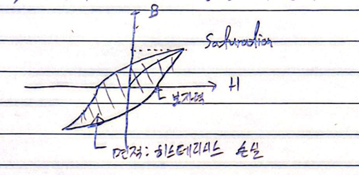

# A. 전자기·자기회로

공부한 날짜: 2026-11-22 ~

진행: 7개 항목 중 3개 정리 (B·H·μ와 자속, 자기회로, B-H 곡선)

## 1. B, H, μ와 자속

### B와 H

| 기호 | 이름 | 영문 |
|---|---|---|
| B | 자속 밀도 | flux density |
| H | 자계 강도 | magnetic field strength |

- 진공에서 B = μ₀·H (μ₀: 진공의 투자율)
- 실제 매질에서는 매질의 투자율을 고려해야 함 → B = μ·H
- μ철 / μ₀ ≈ 1000 ~ 5000

### 자속 Φ (magnetic flux)

$$\Phi_B = \int_S \mathbf{B} \cdot \mathbf{n}\, dS$$

- n: 곡면 S 위의 면적 요소 dS에 수직인 단위벡터

## 2. 자기회로 (기자력, 릴럭턴스, 자속)

### 기자력 (magnetomotive force)

$$\mathcal{F} = \Phi \cdot \mathcal{R} = N \cdot I$$

- N: 코일 감은 수, I: 전류, R: 자기저항

### 릴럭턴스 (reluctance), 자기저항

- 자기회로에서 자속의 흐름을 방해하는 정도

$$\mathcal{R} = \frac{l}{\mu \cdot S}$$

- l: 자로 길이, S: 단면적
- F = N·I(코일 수 × 전류)가 고정이면 R을 줄여야 자속이 커짐

### 공극의 영향

- 공기의 투자율은 철 대비 약 1/5000, 즉 철보다 자기저항이 매우 큼
- 고정된 N·I에서 자속의 크기는 대부분 공극의 자기저항이 결정
- 따라서 공극이 줄어야 자속이 커짐

> Claude 보충: 모터와의 연결
>
> - 전기회로와 대응: 기자력 F ↔ 전압 V, 자속 Φ ↔ 전류 I, 자기저항 R ↔ 저항 R
> - 인덕턴스 L = N² / R, 공극이 자기저항을 대부분 차지하므로 모터의 Ls는 주로 공극 길이로 결정
> - 영구자석의 투자율은 공기와 거의 같음 (μr ≈ 1.05), 그래서 표면 자석형(SPM)은 자석 두께만큼 공극이 넓어진 것과 같고 d축·q축 자기저항이 비슷 → Ld ≈ Lq
> - 철심이 포화되면 μ가 급격히 줄어 R이 커지고 L이 감소 (다음 항목 B-H 곡선에서 정리)

## 3. B-H 곡선, 포화, 히스테리시스

### B-H 곡선

- 기본식 B = μ·H
- B-H 곡선: 물체에 자계 H를 인가할 때 생성되는 B의 관계
- 실제 B-H 곡선은 B와 H가 선형적이지 않음
- 자계를 키우면 자속 밀도는 상승하다가 포화됨

### 잔류 자속 밀도와 자화

- 자계를 인가했다가 0으로 되돌려도 자속 밀도가 남음 → 잔류 자속 밀도 Br
- 자속 밀도와 자계의 차이를 자화(magnetization) M이라고 함

$$M = \frac{B}{\mu_0} - H$$

### 히스테리시스

- 자계가 증가하는 방향과 감소하는 방향에서 자속 밀도가 다름 → 히스테리시스 특성
- 잔류 자속 밀도 Br을 0으로 만드는 반대 방향 자계의 크기 → 보자력 Hc
- 루프 곡선의 면적이 손실을 의미 → 히스테리시스 손실

### 추가 공부: 인덕턴스 (점검 질문을 위해)

$$L = \frac{\lambda}{I} = \frac{N\Phi}{I}, \qquad \mathcal{F} = \Phi \cdot \mathcal{R} = N \cdot I$$

$$\Rightarrow L = \frac{N^2}{\mathcal{R}} = \frac{\mu N^2 S}{l} \qquad \left(\mathcal{R} = \frac{l}{\mu S}\right)$$

- λ(쇄교자속) ∝ 전류, 감은 수²

### 철심이 포화되면 인덕턴스는?

- 철심의 포화는 투자율 μ의 감소를 의미
- 릴럭턴스 R = l/(S·μ)이므로 R은 증가
- 인덕턴스 L = μN²S/l도 감소

> 수정: 공책에는 "R의 감소"로 적혀 있었으나, μ가 줄면 R = l/(μS)는 커지므로 "증가"로 고침

> Claude 보충: 포화와 모터
>
> - 포화되어도 B가 완전히 멈추지는 않고 μ₀ 기울기로 조금씩 증가, 철이 더 이상 자속을 늘려 주지 못하는 상태
> - 투자율은 두 가지: 진폭 투자율 B/H(원점에서 그은 직선의 기울기)와 증분 투자율 dB/dH(접선 기울기), 포화 시 증분 투자율이 훨씬 크게 감소
> - 인덕턴스도 겉보기 L = λ/i와 증분 L = dλ/di로 나뉨, 전류 루프 응답과 리플은 증분 L이 결정
> - 같은 자속이면 단면적이 좁은 곳의 B가 커서 티스 끝 같은 좁은 부분부터 국부적으로 포화
> - 전기강판(연자성체)은 루프가 좁아 손실이 적고, 영구자석(경자성체)은 Br·Hc가 커서 루프가 넓음
> - 히스테리시스 손실은 1초에 루프를 도는 횟수에 비례하므로 모터가 빨라질수록 철손 증가

## 점검 질문 답

공책 내용 기준으로 정리

- 질문: 자속밀도와 자계 세기의 차이는? 철과 공기의 투자율은 얼마나 다른가?
- 답: B는 자속 밀도, H는 자계 강도, 진공에서 B = μ₀H이고 실제 매질에서는 투자율을 반영해 B = μH, 철의 투자율은 진공의 약 1000~5000배

- 질문: 공극이 있는 철심의 자속을 전기회로처럼 계산할 수 있나?
- 답: Φ = N·I / R_total, R_total = R_철 + R_공극이고 R = l/(μS), 공기 투자율이 매우 작아서 R_공극이 대부분을 차지

- 질문: 철심이 포화되면 인덕턴스는 어떻게 변하나?
- 답: 포화로 투자율 μ가 줄면 릴럭턴스 R = l/(μS)가 커지고, L = N²/R = μN²S/l은 감소

## 질문과 답

Claude에게 질문하며 정리한 내용 (2026-11-22)

- 포화 시 투자율이 감소하는가? → 감소, 특히 접선 기울기(증분 투자율)가 크게 떨어져 μ₀ 수준까지 감소
- 인덕턴스를 전류가 만드는 자속 밀도로 봐도 되나? → 아님, L은 전류 1 A당 쇄교자속의 비율(λ/i)이고 코일 구조(N, μ, S, l)로 정해짐, 감은 수가 많을수록 커짐(N²)
- 쇄교자속 기호는 ψ인가 λ인가? → 둘 다 쓰임 (미국 교재 λ, 유럽·IEC 계열 ψ), 이 레포에서는 λ로 통일
- 릴럭턴스의 면적 S는? → 자속이 흐르는 방향에 수직인 자로의 단면적, 공극은 마주 보는 면의 넓이
- 쇄교자속의 다른 상관관계는? → 감은 수(코일 성분 N², 자석 성분 N), 자로 구조, 회전자 위치(역기전력의 원인), 다른 상 전류(상호 인덕턴스), 온도(자석 성분 감소), v = Ri + dλ/dt로 전압과 연결
- 여기서 말하는 포화가 B-H 곡선의 자속 밀도 포화인가? → 맞음, 자화 M이 최댓값에 도달해 B가 H에 비례하지 않게 되는 구간

## 원본

- [공책 스캔 (1·2번 항목)](originals/a-2026-11-22-1.pdf)
- [공책 스캔 (3번 항목)](originals/a-2026-11-22-2.pdf)
